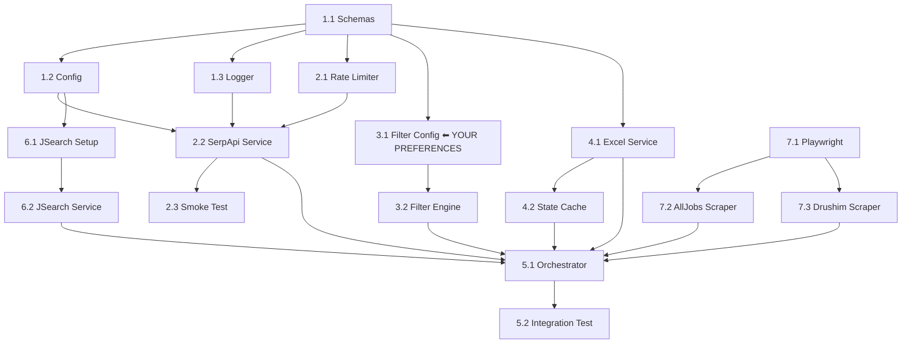

# JobScout — Implementation Plan

> Derived from [PRD.md](file:///f:/Programming/new%20stuff/JobScout/PRD.md) · Generated 2026-05-10

## Current State

| Item | Status |
|---|---|
| `package.json` + deps | ✅ Installed (axios, exceljs, dotenv, zod, typescript, tsx) |
| `tsconfig.json` | ✅ Strict mode, ESNext, NodeNext, `"type": "module"` |
| `.gitignore` → `.env` | ✅ Already listed |
| `.env` | ✅ Exists with `SERPAPI_KEY` + `OUTPUT_PATH` |
| `src/types/schemas.ts` | ✅ `JobEntry` + `AppConfig` schemas |
| `src/utils/config.ts` | ✅ Config loader with Zod validation |
| `src/utils/logger.ts` | ✅ Structured JSON logger |
| `src/utils/rateLimiter.ts` | ✅ Rate limiter class |
| `src/services/SerpApiService.ts` | ✅ Working (remote queries only — Google Jobs has no Israel coverage) |

---

## Stage 1 — Type System & Configuration ✅

> All tasks complete. See files above.

---

## Stage 2 — Data Acquisition ✅ (SerpApi) + 🔜 (more sources)

> **Discovery:** Google Jobs via SerpApi has **zero coverage for Israel**. SerpApi works for remote-only queries. Additional data sources are planned in Stages 6-7.

### Task 2.1 · Rate limiter ✅
### Task 2.2 · SerpApi service ✅
### Task 2.3 · Smoke test ✅

> Smoke test confirmed: remote queries return 10 results, Israel queries return 0.

---

## Stage 3 — Filter Engine

> **Goal:** Score and filter job entries based on the user's personal criteria.

> [!IMPORTANT]
> **Before building this stage**, the user needs to provide their full job preferences:
> - What **job titles/roles** are you targeting? (not just dev — what else?)
> - What **technologies/skills** should boost a job's priority?
> - What **keywords** should instantly reject a job?
> - What makes a job **"High Priority"** vs. just acceptable?

### Task 3.1 · Define filter configuration

- **File:** `src/types/filterConfig.ts`
- **What:**
  - Export `SEARCH_QUERIES` — moved here from service files, shared across all data sources
  - Export `INCLUDE_TAGS` — technologies/keywords that boost a job's score
  - Export `EXCLUDE_TAGS` — keywords that instantly reject a job
  - Export `HIGH_PRIORITY_TAGS` — keywords that mark a job as top-tier
- **Why:** Separating config from logic means tuning your search criteria never touches the algorithm code. All data sources share the same query list.
- **Architecture:** Search queries live here (not in individual services) because they're source-agnostic — the same queries feed SerpApi, JSearch, and scrapers.

### Task 3.2 · Build the filter utility

- **File:** `src/utils/filterEngine.ts`
- **What:**
  - Export `filterJobs(jobs: JobEntry[]): JobEntry[]`
    1. **Reject** if title OR description contains any `EXCLUDE_TAGS` entry (case-insensitive)
    2. **Score** remaining jobs: +1 per `INCLUDE_TAGS` match, +3 per `HIGH_PRIORITY_TAGS` match
    3. **Set `priority`** field: `"High"` if score ≥ 5, `"Medium"` if ≥ 2, `"Low"` otherwise
    4. **Sort** descending by score
  - Log summary: `"Filtered X → Y jobs (Z high priority)"`
- **Acceptance:** Given a mock array with a "Senior React Dev" and a job matching your high-priority tags, the first is rejected and the second is marked High Priority.

---

## Stage 4 — Excel Output & Deduplication

> **Goal:** Write filtered results to a styled `.xlsx` file, preventing duplicates across runs.

### Task 4.1 · Build the Excel service

- **File:** `src/services/ExcelService.ts`
- **What:**
  - Export `writeJobs(jobs: JobEntry[], filePath: string): Promise<void>`
  - Columns: `[Date, Priority, Job Title, Company, Location, Link, Status]`
  - If file exists → load it; if not → create with headers
  - **Deduplication:** Hash each job's `Link` field. Before appending, check if the hash already exists in the sheet. Skip duplicates.
  - Batch-write all new rows atomically (Rule §5)
  - Apply basic styling: bold headers, auto-width columns, color-coded Priority column (green/yellow/gray)
- **Acceptance:** Running twice with the same data produces no duplicate rows.

### Task 4.2 · Create state cache for crash recovery

- **File:** `src/utils/stateCache.ts`
- **What:**
  - Read/write `.cache/state.json`
  - Track: `lastRunTimestamp`, `lastProcessedQueryIndex`, `totalJobsAdded`
  - Export `loadState()` and `saveState()` functions
  - On first run, create `.cache/` directory + seed file
- **Why:** Rule §5 requires resumable state so the bot can pick up where it left off after a crash.
- **Acceptance:** Kill the process mid-run → restart → resumes from the correct query.

> [!IMPORTANT]
> Add `.cache/` to `.gitignore` before creating any cache files.

---

## Stage 5 — Orchestration & Summary

> **Goal:** Wire everything into a single entry point with human-readable run summaries.

### Task 5.1 · Create the main orchestrator

- **File:** `src/index.ts`
- **What:**
  1. Load config
  2. Load state cache (resume point)
  3. For each data source + each query (starting from `lastProcessedQueryIndex`):
     - `fetchJobs(query)` → `filterJobs(results)` → `writeJobs(filtered, outputPath)`
     - Update state cache after each query
  4. Log final summary: `"Scanned X jobs → Y matches → Z new roles added to sheet."`
  5. Wrap in top-level try/catch with `Logger.error` for unhandled failures
- **Acceptance:** `npm run dev` executes the full pipeline end-to-end and produces a populated `.xlsx`.

### Task 5.2 · Final integration test

- **Manual verification checklist:**
  - [ ] `.env` missing a key → clear Zod error, exit 1
  - [ ] API returns garbage → Zod validation error logged, no crash
  - [ ] Excluded roles → filtered out
  - [ ] High-priority roles → marked correctly
  - [ ] Run twice → no duplicate rows in Excel
  - [ ] Kill mid-run → restart picks up from last query

---

## Stage 6 — JSearch API (Israel Coverage)

> **Goal:** Add a second data source that actually covers Israeli job listings.

### Task 6.1 · Set up JSearch on RapidAPI

- **What:**
  - Sign up at RapidAPI, subscribe to JSearch (free tier: 200 req/month)
  - Add `JSEARCH_API_KEY` to `.env` and `AppConfigSchema`
- **Acceptance:** Key is in `.env`, schema validates it.

### Task 6.2 · Create JSearch service

- **File:** `src/services/JSearchService.ts`
- **What:**
  - Same pattern as SerpApiService: private raw schemas, exports `fetchJobs(query): Promise<JobEntry[]>`
  - Queries with Israel/Tel Aviv/Ramat Gan location targeting
  - Uses the shared `RateLimiter`
- **Why:** JSearch (a Google Jobs proxy) has better international coverage including Israel.
- **Acceptance:** Fetching "developer Tel Aviv" returns actual Israeli job listings.

### Task 6.3 · Update orchestrator

- Update `index.ts` to loop through both SerpApi (remote) and JSearch (Israel) results.

---

## Stage 7 — Israeli Job Board Scrapers

> **Goal:** Scrape native Israeli job boards for listings that don't appear on Google Jobs at all.

### Task 7.1 · Install Playwright

- Add `playwright` as a dependency for browser-based scraping.

### Task 7.2 · Create AllJobs scraper

- **File:** `src/services/AllJobsScraper.ts`
- **What:**
  - Scrape AllJobs.co.il search results
  - Same contract: returns `JobEntry[]`
  - Handle Hebrew content and pagination
- **Why:** AllJobs is the #1 Israeli job board. Many local positions never appear on Google Jobs.

### Task 7.3 · Create Drushim scraper (optional)

- **File:** `src/services/DrushimScraper.ts`
- Same pattern as AllJobs but for Drushim.co.il.

---

## Dependency Graph

## Task Order (Linear Execution)

| # | Task | File | Status |
|---|---|---|---|
| 1 | Schemas & Types | `src/types/schemas.ts` | ✅ |
| 2 | Config Loader | `src/utils/config.ts` | ✅ |
| 3 | Logger | `src/utils/logger.ts` | ✅ |
| 4 | Rate Limiter | `src/utils/rateLimiter.ts` | ✅ |
| 5 | SerpApi Service | `src/services/SerpApiService.ts` | ✅ |
| 6 | Smoke Test | `src/services/__tests__/serpapi.smoke.ts` | ✅ |
| 7 | **⬅ USER: Provide full job preferences** | — | ⏳ |
| 8 | Filter Config | `src/types/filterConfig.ts` | ⬜ |
| 9 | Filter Engine | `src/utils/filterEngine.ts` | ⬜ |
| 10 | Excel Service | `src/services/ExcelService.ts` | ⬜ |
| 11 | State Cache | `src/utils/stateCache.ts` | ⬜ |
| 12 | Orchestrator | `src/index.ts` | ⬜ |
| 13 | Integration Test | Manual | ⬜ |
| 14 | JSearch Setup | `.env` + schema | ⬜ |
| 15 | JSearch Service | `src/services/JSearchService.ts` | ⬜ |
| 16 | Playwright Setup | `package.json` | ⬜ |
| 17 | AllJobs Scraper | `src/services/AllJobsScraper.ts` | ⬜ |
| 18 | Drushim Scraper | `src/services/DrushimScraper.ts` | ⬜ |
